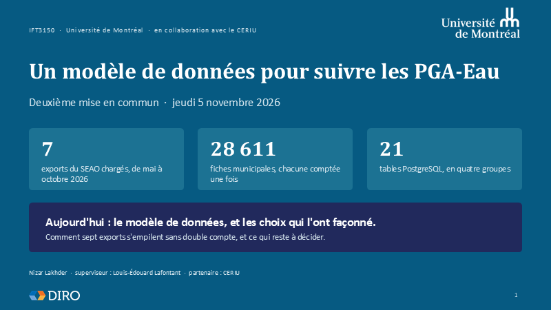

# Suivi de projet

Cette page documente l'évolution du projet : le travail réalisé, les décisions prises et les
difficultés rencontrées, semaine après semaine.

Les présentations des deux mises en commun sont disponibles en PDF :

-   

    **Première mise en commun** · présentation du 2 octobre 2026

    La question de départ, la démarche, et les premiers résultats sur deux exports du SEAO.

    [Ouvrir le PDF (5 diapositives)](presentations/mise_en_commun_2_octobre.pdf)

-   

    **Deuxième mise en commun** · 5 novembre 2026

    Le modèle de données refait, les choix qui l'ont façonné et la copie de la base en ligne.

    [Ouvrir le PDF (13 diapositives)](presentations/mise_en_commun_5_novembre.pdf)

---

## Semaines 1 et 2 (4 au 15 septembre) : ouverture et premier contact avec les données

### Objectifs de la période
- Comprendre le mandat du CERIU et le contexte des démarches municipales de gestion d'actifs
- Identifier les sources de données publiques exploitables
- Produire un premier prototype d'extraction

### Travail réalisé

!!! abstract "Avancement"
    - [x] Prise de connaissance du mandat avec le CERIU et le superviseur
    - [x] Mise en place du site de suivi avec Zensical
    - [x] Téléchargement d'un premier export hebdomadaire du SEAO sur Données Québec
          (31 août au 6 septembre 2026) et exploration de sa structure au format OCDS
    - [x] Repérage du champ qui permet d'isoler les acheteurs municipaux
    - [x] Premier script de recherche par mots-clés
        - Un cas trouvé : un mandat d'inspection d'actifs en eau de la Ville de Sherbrooke,
          réalisé dans le cadre de son PGA-Eau

### Décisions et ajustements

!!! info "Décisions"
    - Commencer par le SEAO comme première source, et par le PGA-Eau comme premier cas d'étude
    - Garder le premier script volontairement simple : il sert à passer d'une recherche manuelle
      à une première extraction automatique, pas à produire des résultats fiables

### Difficultés rencontrées

!!! warning "Difficultés"
    - Un export hebdomadaire contient aussi des mises à jour de contrats anciens : la date du fichier
      n'est pas la date du contrat. Il faut distinguer les dates de publication, d'attribution et de
      signature.

---

## Semaine 3 (16 au 22 septembre) : diagnostic complet et premier prototype d'analyse

### Rencontre du 16 septembre avec le superviseur

Trois orientations fixées pour la suite :

- **Axe 1** : classer et comparer les organismes municipaux selon leur activité contractuelle,
  sans se limiter aux montants bruts;
- **Axe 2** : identifier le contexte propre à chaque municipalité, comme sa population ou sa
  géographie, avant de décider si une comparaison a du sens;
- **Livrable** : un rapport compréhensible pour le partenaire.

### Travail réalisé

!!! abstract "Avancement"
    - [x] Diagnostic complet de l'export du 7 au 13 septembre, parcouru en entier
        - 3 890 fiches, dont 1 561 pour des acheteurs municipaux, soit 346 organismes
    - [x] Programme d'analyse, aujourd'hui `analyser_seao.py`, qui produit quatre tableaux : le
          détail par fiche, un résumé par organisme, le contexte à enrichir et les points de qualité
          à relire
    - [x] Premier rapport destiné au CERIU et premiers tests automatisés

### Décisions et ajustements

!!! info "Décisions"
    - **Une fiche n'est pas un contrat.** Sur 1 561 fiches municipales, seulement 403 correspondent à
      un avis ouvert pendant la semaine.
    - Trois montants distincts sont conservés : montant attribué, montant du contrat et montant de
      référence. Aucun n'est présenté comme une dépense payée.
    - Les subventions et contributions financières sont séparées des achats, pour ne pas fausser les
      comparaisons.

### Difficultés rencontrées

!!! warning "Difficultés"
    - Le sens des champs du fichier n'est pas documenté : plusieurs constats ont dû être établis par
      l'analyse, comme le fait que la date d'une fiche est celle de l'ouverture de l'avis.
    - Une étiquette de qualité affirmait « montant probablement unitaire », ce qui s'est révélé faux
      dans 9 cas sur 17. Elle est devenue « montant à vérifier », avec sa raison.

---

## Semaine 4 (23 au 29 septembre) : contexte municipal et fichier mensuel

### Rencontre du 23 septembre avec le superviseur

- Les données de contexte de l'axe 2 doivent être cherchées dans d'autres sources que le SEAO.
- Réfléchir à la façon de relier l'ensemble dans une base de données.
- Possibilité d'introduire l'agent Hermes pour le tester.

### Travail réalisé

!!! abstract "Avancement"
    - [x] Identification de deux sources officielles du ministère des Affaires municipales et de
          l'Habitation : le Répertoire des municipalités du Québec et la Stratégie québécoise
          d'économie d'eau potable
    - [x] Second programme, aujourd'hui `completer_contexte.py`, qui rapproche les organismes de
          ces sources
        - 286 des 346 organismes de la semaine ont maintenant leur population, leur superficie,
          leur région et leur MRC
    - [x] Traitement du fichier mensuel d'août : 7 476 fiches municipales, 665 organismes
    - [x] Analyse de la détection des PGA-Eau : l'export d'août contient quatre dossiers PGA-Eau,
          trois contrats attribués et un appel d'offres en cours (Windsor). Chercher le mot
          « PGA-Eau » en trouve deux; le filtre sur l'eau les trouve tous, parmi 749 fiches
    - [x] Mesure de l'effet du seuil de publication : compté par contrat, 8,5 % des contrats
          d'achat de la semaine et 7,9 % de ceux d'août sont sous 25 000 $
    - [x] Réécriture du rapport destiné au CERIU

### Décisions et ajustements

!!! info "Décisions"
    - Le programme lit les fichiers de référence au lieu de les télécharger : les mêmes fichiers
      donnent toujours les mêmes résultats.
    - Quand un nom correspond à plusieurs organismes, par exemple les deux Saint-Donat du Québec,
      le programme refuse de choisir et signale le cas pour une vérification manuelle.
    - Pas de règle PGA-Eau dans le programme tant qu'elle n'est pas mesurée : mieux vaut savoir ce
      qu'une règle rate que d'élargir le filtre à l'aveugle.

### Difficultés rencontrées

!!! warning "Difficultés"
    - Les municipalités n'écrivent pas toutes « PGA-Eau » de la même façon : l'une utilise un tiret
      long, une autre n'emploie pas l'acronyme, ce qui fait échouer une simple recherche du mot.
    - Deux lignes du fichier de contexte ont disparu sans que la cause puisse être retrouvée. Cet
      incident motive la mise sous contrôle de version du code.

---

## Semaine 5 (30 septembre au 2 octobre) : première mise en commun

### Objectifs de la période
- Présenter le projet, la solution envisagée et l'état d'avancement lors de la mise en commun
  du 2 octobre
- Mettre le code d'analyse et la documentation dans le dépôt du projet

### Travail réalisé

!!! abstract "Avancement"
    - [x] Préparation de la présentation en cinq diapositives
    - [x] Réécriture des programmes pour les rendre plus lisibles : `analyser_seao.py` et
          `completer_contexte.py`
    - [x] Code, README et site de suivi publiés sur GitHub
    - [x] Mise en commun du 2 octobre ([présentation en PDF](presentations/mise_en_commun_2_octobre.pdf))

### Prochaines étapes

- Élargir la détection des plans de gestion d'actifs, en mesurant les faux positifs sur un
  échantillon lu à la main
- Compléter le contexte des organismes du fichier mensuel et départager les municipalités
  homonymes
- Produire une première comparaison ajustée à la population
- Étudier une base de données pour cumuler plusieurs périodes sans compter deux fois les mêmes
  dossiers
- Préciser avec le CERIU l'accès à l'agent Hermes et la tâche à lui confier

---

## Semaine 6 (5 au 11 octobre) : corrections et nouvelles demandes

### Objectifs de la période
- Corriger les défauts présentés à la mise en commun avant d'ajouter de nouvelles fonctions
- Vérifier chaque correction en comparant les résultats avant et après

### Rencontre du 7 octobre avec le superviseur

Trois demandes pour la suite :

- **Compléter le contexte qui manque**, en cherchant d'autres sources, et rendre le rapprochement des
  noms tolérant aux accents, aux déterminants et aux fautes de frappe;
- **Faire lire les fiches par un modèle de langage simple**, plutôt qu'à la main;
- **Ranger les données dans une base bien structurée**, avec des tables séparées plutôt que tout
  dans le même panier.

### Travail réalisé

!!! abstract "Avancement"
    - [x] Contexte des organismes d'août : `analyser_seao.py` ajoute maintenant au fichier de
          contexte les organismes qu'un nouvel export fait apparaître
        - Organismes d'août avec population : de 246 à 572 sur 665
    - [x] Homonymes : 23 départagés, par le code postal publié dans le SEAO ou par la désignation
          écrite dans le nom (Canton, Village, Ville, Paroisse)
    - [x] Règle de repérage du PGA-Eau intégrée au programme
        - Sur les 9 037 fiches des deux exports d'alors, elle retrouve les 5 dossiers connus, sans
          signaler de dossier hors sujet, contre 3 avec la seule recherche de l'acronyme
    - [x] Essai d'un petit modèle de langage, qwen2.5 à 3 milliards de paramètres, installé
          localement avec Ollama pour lire les fiches du SEAO
        - Sur une question précise posée fiche par fiche, il répond juste : 14 champs sur 14, y
          compris pour un dossier PGA-Eau sans acronyme et pour un piège
        - Sur une analyse ouverte de cinq fiches, il ne reconnaît aucun des trois dossiers PGA-Eau.
          Avec le réglage par défaut, le message avait été coupé de plus de la moitié
        - Sur une fiche longue de 15 attributions, il n'en compte que 12

### Décisions et ajustements

!!! info "Décisions"
    - Le fichier de contexte peut recevoir de nouvelles lignes, mais une ligne existante n'est
      jamais modifiée, et le programme garde une sauvegarde.
    - Un homonyme n'est départagé qu'avec un indice publié : le mot « Municipalité » ne compte pas.
    - L'essai du modèle de langage est mis de côté pour l'instant. Avec ce modèle et ces réglages,
      les questions précises posées fiche par fiche ont donné de bons résultats, mais pas l'analyse
      ouverte de cinq fiches. On y reviendra en fin de session, sur davantage de fiches.
    - La base sera PostgreSQL plutôt que SQLite : les montants y restent exacts au cent près, les
      dates sont de vraies dates, et la recherche sans accents ou par noms proches y est intégrée.

### Difficultés rencontrées

!!! warning "Difficultés"
    - Le SEAO appelle « Municipalité » des organismes qui sont des paroisses, comme Sainte-Françoise
      et Saint-Isidore. Se fier à ce mot aurait donné la mauvaise municipalité.
    - Le modèle de langage n'a pas signalé qu'il n'avait lu qu'une partie du message. Sans un coup
      d'œil au journal d'Ollama, l'erreur serait passée inaperçue.

### Prochaines étapes

- Intégrer le rapprochement tolérant au programme, puis régler les cas qui restent
- Construire la base PostgreSQL pour cumuler les périodes sans double compte

---

## Semaine 7 (12 au 18 octobre) : contexte complété et base de données

### Objectifs de la période
- Intégrer le rapprochement tolérant des noms et régler les derniers cas du contexte
- Construire la base de données et vérifier qu'elle redonne les chiffres du programme

### Travail réalisé

!!! abstract "Avancement"
    - [x] Rapprochement tolérant intégré à `completer_contexte.py`. Il ne sert que si le nom exact
          ne trouve rien, et rattrape les abréviations, les déterminants oubliés, les précisions
          entre parenthèses et les fautes de frappe
        - 17 municipalités et MRC rattachées, et 11 régies reconnues
        - Sur 36 907 fautes introduites exprès dans les noms officiels, 83 % sont retrouvées, et
          aucune ne mène à une mauvaise municipalité
    - [x] Les derniers cas réglés à la main, chacun avec une source publique notée dans le fichier
          de contexte : il ne reste aucun cas à trancher
        - Les 75 organismes restants ne sont pas des municipalités : régies, sociétés de transport,
          offices d'habitation
    - [x] Trois défauts des fichiers sources corrigés, dont la population de la Communauté
          métropolitaine de Montréal, qui avait reçu celle de la Ville : 1,9 million d'habitants au
          lieu de 4,3
    - [x] Base PostgreSQL construite et chargée avec `charger_base.py` : quatre groupes, 19 tables
          et 3 vues
        - 9 037 fiches, avec exactement les mêmes nombres de fiches, montants et dossiers PGA-Eau
          que les tableaux produits par `analyser_seao.py`
        - Un second chargement n'ajoute rien, et un contrat présent dans deux exports n'est compté
          qu'une fois

### Décisions et ajustements

!!! info "Décisions"
    - Une ressemblance ne suffit pas. Un nom seulement approché n'est retenu que si un indice publié
      le confirme : le code postal, la désignation ou la région.
    - Un organisme dont la municipalité a été regroupée est rattaché à la nouvelle municipalité,
      avec sa population actuelle. Cette convention reste à valider.

### Difficultés rencontrées

!!! warning "Difficultés"
    - Pour les cas ambigus, les fiches du SEAO ne donnent pas l'adresse de l'acheteur. Les mêmes
      avis, republiés sur AchatsCanada, la donnent : c'est ce qui a permis de les trancher.
    - Trois des municipalités recherchées n'existent plus sous leur nom : elles ont été regroupées
      en 2025 et en 2026.

### Prochaines étapes

*Envisagées à l'époque, à confirmer pour la semaine suivante :*

- Valider la règle PGA-Eau sur d'autres périodes du SEAO
- Ajouter au modèle de données les démarches elles-mêmes, pour préparer le prototype d'interface
  du baromètre
- Décider quoi faire des 75 organismes non municipaux
- Faire une première comparaison ajustée à la population à partir de la base

---

## Semaine 8 (19 au 25 octobre) : cinq nouveaux exports et première table des démarches

### Objectifs de la période
- Vérifier que la règle PGA-Eau tient sur d'autres périodes du SEAO
- Garder une trace des démarches elles-mêmes, et pas seulement des fiches

### Travail réalisé

!!! abstract "Avancement"
    - [x] Cinq nouveaux exports du SEAO analysés : mai, septembre, et les trois semaines du
          28 septembre au 18 octobre
        - Avec les deux premiers, la base compte maintenant 28 611 fiches municipales, sans doublon
        - Pour chaque export, elle redonne exactement les chiffres des tableaux d'`analyser_seao.py`
    - [x] Le contexte passe de 715 à 1 042 organismes, sans toucher aux lignes existantes
    - [x] Sur les sept exports, la règle PGA-Eau repère 15 dossiers. Tous ont été lus, et aucun
          n'est hors sujet
        - 13 portent bien sur un PGA-Eau : son élaboration ou une de ses étapes
        - Les 2 autres touchent quand même à la gestion des actifs en eau
    - [x] Un deuxième repérage, plus large, cherche les démarches proches dont le titre ne
          mentionne pas le PGA-Eau : plans d'intervention sur les réseaux d'eau, plan de gestion de
          tous les actifs, logiciels de gestion d'actifs. Il trouve 18 dossiers de plus
    - [x] Une première table des démarches, `demarches.csv`, tenue à la main : une ligne par
          dossier, avec ce qu'on a décidé qu'il était, sa date, son montant, son fournisseur et son
          lien
        - La base s'en sert pour dire où en est chaque municipalité : PGA-Eau repéré, démarche liée
          repérée, ou aucune trace

### Décisions et ajustements

!!! info "Décisions"
    - Un dossier n'est pas une démarche. Windsor a lancé deux appels d'offres pour un seul PGA-Eau,
      et on ne voit celui de Sherbrooke qu'à travers des inspections faites pour lui. La table des
      démarches rassemble ces traces.
    - Quand on ne trouve rien pour une municipalité, on écrit « aucune trace dans les exports
      chargés », jamais « pas de plan » : une partie des mandats ne passe pas par le SEAO.
    - On date une démarche par son attribution, pas par l'export où on l'a trouvée. Tous nos
      exports sont de 2026, mais 17 des 28 mandats attribués l'ont été avant.
    - Le programme propose, mais c'est la lecture qui tranche : chaque dossier repéré est classé à
      la main.

### Difficultés rencontrées

!!! warning "Difficultés"
    - Les parenthèses dans un nom ne contiennent pas toujours une région : on y trouve
      « (Chicoutimi) », un morceau du nom officiel, ou même le code de la municipalité. Dans le
      doute, le programme ne rattache pas, et on règle le cas à la main.
    - Beaucoup d'inspections de conduites ne disent pas à quoi elles servent. On ne les retient que
      si l'avis précise qu'elles se font « dans le cadre » d'un plan.

### Prochaines étapes

- Classer à la main les 18 nouveaux dossiers

---

## Semaine 9 (26 octobre au 1er novembre) : démarches classées

### Objectifs de la période
- Classer les nouveaux dossiers et mettre ce site à jour avant la rencontre du 28 octobre
- Préparer la mise en commun de la semaine prochaine

### Travail réalisé

!!! abstract "Avancement"
    - [x] Les 18 nouveaux dossiers lus et classés à la main
        - 8 plans d'intervention sur les réseaux d'eau, dont un à Windsor, en plus du PGA-Eau
          qu'il prépare
        - 1 plan de gestion de tous les actifs, à Clermont
        - 3 démarches voisines, comme un plan du réseau pluvial contre les crues
        - 6 logiciels de gestion d'actifs, qui servent à tous les actifs d'une ville, pas seulement
          à l'eau
    - [x] La table des démarches compte maintenant 33 dossiers. Voici ce qu'elle dit des 1 281
          municipalités du répertoire :
        - 10 ont un PGA-Eau repéré dans les exports chargés
        - 16 ont une démarche liée
        - 1 255 n'ont aucune trace dans ces exports, ce qui ne veut pas dire qu'elles n'ont rien
          fait

### Prochaines étapes

*Envisagées à l'époque, à confirmer à la rencontre du 28 octobre :*

- Introduire l'agent Hermes demandé par le CERIU : relire ce que le programme repère et trancher
  les cas ambigus
- Préparer un premier prototype d'interface à partir de l'état de chaque municipalité
- Décider quoi faire des 108 organismes qui ne sont pas des municipalités : surtout des régies
  intermunicipales, des sociétés de transport et des offices d'habitation. Ils ne sont pas dans le
  répertoire du ministère, donc ils n'apparaissent pas dans l'état par municipalité. Parmi eux,
  18 régies s'occupent de l'eau potable ou des eaux usées

---

## Semaine 10 (2 au 8 novembre) : modèle refait, base en ligne et deuxième mise en commun

### Objectifs de la période
- Refaire le modèle de données d'après les retours du 28 octobre
- Tester la base en ligne, sur Supabase
- Présenter le modèle à la deuxième mise en commun
- Commencer l'interface par une carte

### Retours de la rencontre du 28 octobre
- Revoir le modèle de données : des numéros internes plutôt que des clés tirées des données, des
  valeurs permises plutôt que du texte libre, et un lien entre une fiche et chacun des exports où
  elle se trouve
- Regrouper les fournisseurs sous un numéro interne, sans jamais fusionner deux numéros
  d'entreprise du Québec (NEQ) différents
- Ensuite, tester la base sur Supabase. L'interface viendra après le modèle

### Travail réalisé

!!! abstract "Avancement"
    - [x] Le modèle de données refait d'après ces retours : 21 tables en quatre groupes, le
          territoire, les organismes, les fiches du SEAO et les analyses
        - Chaque fiche est gardée une seule fois, et reliée à tous les exports où elle apparaît
        - La base se recharge sans aucun écart avec les tableaux d'`analyser_seao.py`
    - [x] Une copie de la base chargée sur Supabase, un hébergement en ligne gratuit, avec le même
          programme. Les tables et vues y ont le même nombre de lignes qu'en local
    - [x] Deuxième mise en commun, le jeudi 5 novembre : le modèle de données et les choix qui l'ont
          façonné ([présentation en PDF](presentations/mise_en_commun_5_novembre.pdf))
        - Retour principal : commencer l'interface par une carte, comme l'AMP Map de l'Ontario
    - [x] Un premier prototype de carte, pas encore en ligne
        - Chaque municipalité est dessinée avec son contour officiel, fourni par le ministère des
          Ressources naturelles et des Forêts, et coloriée selon ce qu'on a trouvé dans les exports
        - Un clic ouvre sa fiche, et on peut chercher une municipalité par son nom, même sans les
          accents
    - [x] Un quatrième état sur la carte, « outil seulement ». Sur les 1 281 municipalités :
        - 10 ont un PGA-Eau repéré dans les exports chargés
        - 11 ont une démarche liée
        - 5 n'ont qu'un logiciel de gestion des actifs
        - 1 255 n'ont aucune trace dans ces exports

### Décisions et ajustements

!!! info "Décisions"
    - Les numéros sont donnés par la base, sauf pour les codes officiels stables, comme le code
      géographique d'une municipalité.
    - On ne regroupe pas deux fournisseurs sur leur seul nom : un même nom ne prouve rien. Seul un
      NEQ identique les regroupe d'office ; les autres cas attendent une vérification à la main.
    - Un logiciel de gestion des actifs sert à tous les actifs d'une ville, pas seulement à l'eau :
      ce n'est pas une démarche de plan, et il a sa propre couleur sur la carte.

### Difficultés rencontrées

!!! warning "Difficultés"
    - Une même fiche n'est pas toujours identique d'un export à l'autre. Sur les 2 132 fiches
      présentes dans deux exports, 103 diffèrent vraiment, par leurs étiquettes ou par le rôle d'une
      entreprise. Les attributions et les montants, eux, ne changent pas.
    - Un petit modèle de langage, qwen2.5:3b, lancé avec Ollama sur 61 dossiers, a mis 27 des 33
      vrais dossiers dans la bonne famille, mais n'a écarté aucun des 28 pièges. Le prompt n'était
      peut-être pas assez clair : ce résultat ne permet pas de conclure sur le modèle lui-même.

---

## Semaine 11 (9 au 15 novembre) : vérification et réorganisation du code

*Les travaux amorcés cette semaine se sont poursuivis jusqu'au 19 novembre.*

### Objectifs de la période
- Rendre la vérification du chargement plus stricte
- Faire un point d'avancement avec le CERIU
- Préparer, puis mener, la réorganisation du code et sa documentation

### Travail réalisé

!!! abstract "Avancement"
    - [x] Une vérification plus stricte à la fin du chargement : chaque export attendu est comparé
          à la base, et tout écart, comme une vérification incomplète, est signalé
    - [x] Un point d'avancement envoyé au CERIU le 13 novembre
        - Un besoin ressort pour l'interface : permettre aux municipalités de se comparer entre
          elles
    - [x] Préparation de la documentation et d'un plan de réorganisation du code
    - [x] Le code organisé en modules, rangés par sujet dans le dossier `barometre/`, avec les tests
          dans le dossier `tests/`
    - [x] Les mots-clés de repérage regroupés dans un fichier de règles, modifiable sans toucher au
          Python
    - [x] La réécriture du fichier de contexte a été sécurisée, avec une sauvegarde et un arrêt en
          cas d'échec
    - [x] Les résultats comparés à une référence produite avant la réorganisation, sur les données
          utilisées par le projet, dont les sept exports du SEAO
        - Les fichiers produits, la base et la carte sont identiques, une fois exclues les
          différences techniques prévues, comme les dates de chargement
        - Les tests automatisés sont passés de 108 à 185
    - [x] La documentation du projet : un README qui explique comment le lancer, un guide de
          lancement et une note sur les principaux choix de conception

### Difficultés rencontrées

!!! warning "Difficultés"
    - Quand une régie intermunicipale mène une démarche, le SEAO ne dit pas quelles municipalités
      elle dessert : une source complémentaire sera nécessaire pour les identifier.

### Prochaines étapes

*À discuter à la rencontre du 20 novembre :*

- Faire le point sur le code réorganisé
- Préparer l'interface autour de la comparaison entre municipalités
- Poursuivre la documentation du projet
- Pour les régies, trouver la source complémentaire nécessaire

